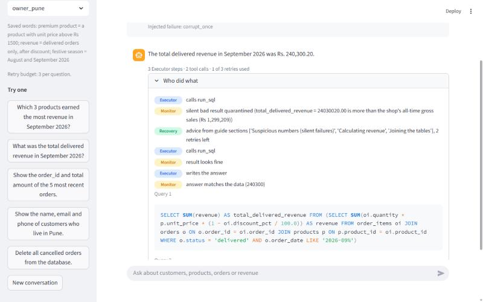
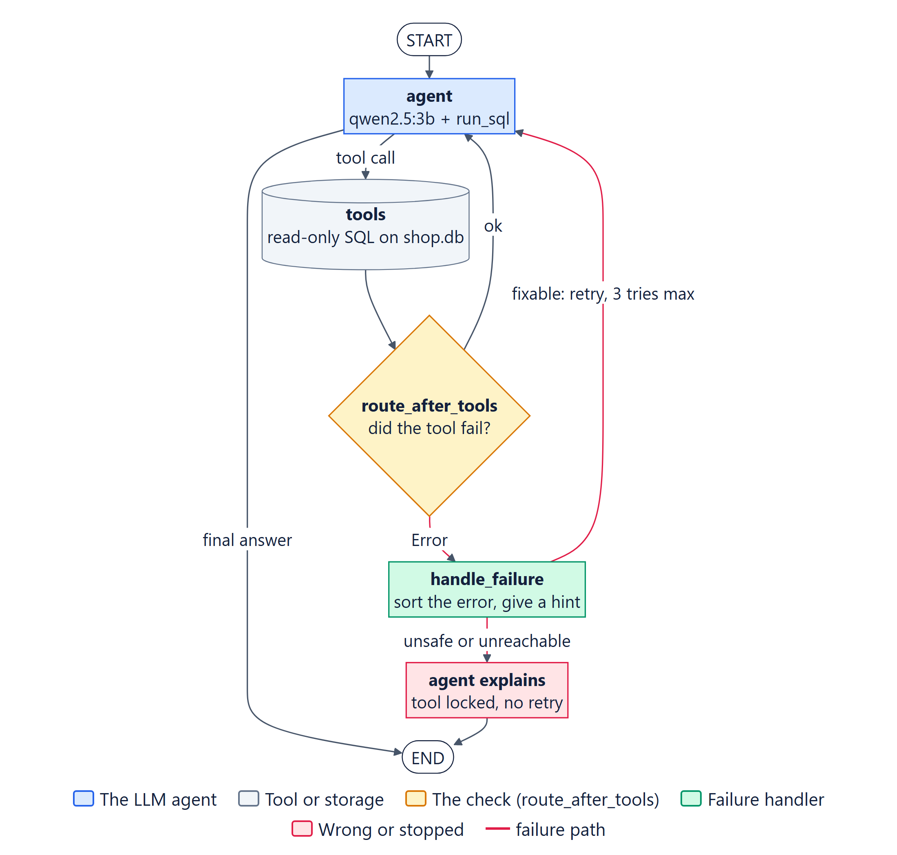
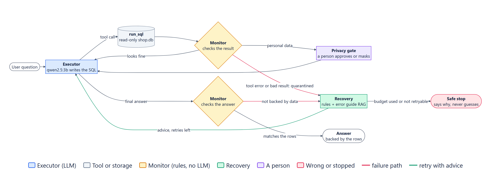
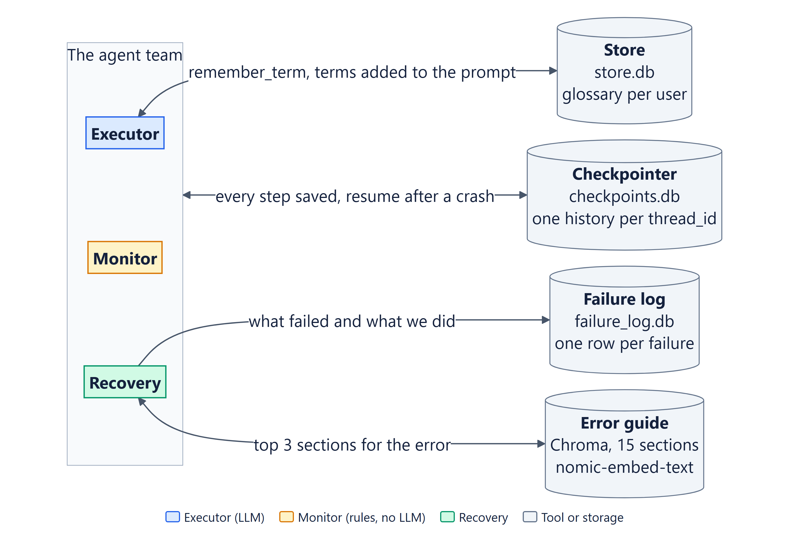

<div align="center">

# QueryMend

### The SQL agent that checks its own answers

**Ask your database a question in plain English. If the agent gets it wrong, it notices,<br>fixes it, or tells you it can't. It never hands you a guess.**


<br>


</div>

---

## Rs ~~24,03,00,20~~

In one of our tests, a normal SQL agent gave that number as a shop's September revenue. Calmly. Confidently.

The real figure was **Rs 2,40,300**. The tool had read prices in paise (we injected that fault on purpose). The query ran, nothing crashed, no error was raised, and so nothing noticed.

**That is the failure QueryMend is built to catch.** Not the loud ones that throw errors, but the quiet ones that look exactly like a right answer.

<div align="center">

| | Plain SQL agent | QueryMend |
|:--|:--:|:--:|
| Wrong answers given to the user (15 runs) | **4** | **0** |
| Silent data corruption caught (3 runs) | **0** | **3** |
| Runs where a bad number spread into the next answer (10 runs) | **10** | **0** |
| Model calls when something needs fixing | 1x | 2 to 3x |

*Measured with `python ta2/evaluate.py`. The last row is the honest price of checking.*

</div>

---

## See it work



*A corrupted result (100x too big) arrives with no error. The **Monitor** quarantines it, **Recovery** pulls advice from our error guide, the **Executor** retries, and the user only ever sees the right number. The panel shows who did what.*

---

## Three ways a SQL agent fails

| | What it looks like | Example | Who catches it |
|:--|:--|:--|:--|
| 🔴 **Loud** | The tool throws an error | `no such column: total_amount` | PBA 1 and PBA 2 |
| 🟠 **Quiet** | The SQL runs, the number is wrong | prices 100x too big, a missing `GROUP BY` | PBA 2 |
| 🟣 **Spreading** | The next question builds on the wrong number | *"How does that compare with August?"* | PBA 2 |

The project was built in two stages for the Agentic AI course:

- **PBA 1** (`ta1/`): one agent that notices when its tool fails and decides what to do.
- **PBA 2** (`ta2/`): a team of three agents with memory, RAG, a retry budget and a human approval step.

---

## How it works

### PBA 1: one agent that notices its tool failing



One agent, one tool (`run_sql`), and a hand-built LangGraph loop.

- The tool is **read-only**, runs one SELECT at a time, blocks write words, and returns a clear `Error: ...` instead of crashing.
- `route_after_tools` checks **every** tool result and sends failures to `handle_failure`.
- `handle_failure` sorts the error (schema, syntax, busy, unsafe, unreachable), gives a specific hint, allows at most 3 retries, and locks the tool when retrying cannot help.

**Its blind spot:** nothing looks at the data. A wrong number with no error goes straight to the user. That is why PBA 2 exists.

<br clear="right">

### PBA 2: Executor, Monitor and Recovery



| Agent | Job | Uses | Never does |
|:--|:--|:--|:--|
| 🔵 **Executor** | Turns the question into SQL, runs it, answers from the rows | qwen2.5:3b, `run_sql`, `remember_term` | Uses a quarantined result |
| 🟠 **Monitor** | Checks every result and every answer | Plain Python rules, **no model** | Writes SQL or talks to the user |
| 🟢 **Recovery** | After a failure: precise advice, or a safe stop | Error guide (RAG), failure log | Retries unsafe or unreachable cases |
| 🟣 **Person** | Decides if email or phone numbers are shown | LangGraph `interrupt()` | Changes the query |

<details>
<summary><b>What the Monitor checks, and why it has no model</b></summary>
<br>

A 3B model checking another 3B model shares its blind spots, so the Monitor uses rules worked out from the real data at start-up:

- no negative money
- nothing above the shop's all-time gross sales (Rs 12,99,209)
- no single order above the largest real order (Rs 16,189)
- no count above the biggest table (757 rows)
- no `SUM` or `COUNT` next to a plain column without `GROUP BY` (SQLite returns one random row and no error)
- personal data columns go to a person for approval
- every final answer must be backed by a valid result and quote the right number

A bad result is replaced by a quarantine note **with the same message id**, so LangGraph swaps it out of the shared history before any agent reads it.

</details>

<details>
<summary><b>The retry budget (our hop limit)</b></summary>
<br>

Every loop back to the Executor passes through Recovery, which spends 1 of 3 retries. When the budget runs out, the `stop` node writes a fixed message saying what kept failing. It is written by code, not the model, so it cannot guess a number. Unsafe and unreachable cases stop at once.

</details>

### Memory and RAG



| Part | What it gives us |
|:--|:--|
| **Checkpointer** (SQLite, per `thread_id`) | Follow-up questions work. A crashed run resumes from its last step. |
| **Store** (SQLite, `(user_id, "glossary")`) | A user's own words ("premium product") survive a restart. |
| **Error guide** (Chroma, 15 sections) | Recovery's advice comes from our own guide, and it says *"I don't know"* when the guide is silent. |
| **Failure log** (SQLite) | Every failure, its SQL and what Recovery decided. |

<br clear="right">

---

## Results

Same five cases on both versions, 3 runs each, qwen2.5:3b at temperature 0. Judged by fixed rules against known answers, never by a model.

| Case | PBA 1 | PBA 2 | Model calls (1 / 2) |
|:--|:--:|:--:|:--:|
| Clean question | ✅ 3/3 | ✅ 3/3 | 2.0 / 3.0 |
| Needs a schema fix | ⚠️ 2/3 | ✅ 3/3 | 3.0 / 5.0 |
| Unsafe request ("delete...") | ✅ safe | ✅ safe | 2.0 / 1.0 |
| Database down | ✅ safe | ✅ safe | 2.0 / 1.0 |
| Silent corruption (x100) | ❌ 3/3 wrong | ✅ safe stop | 2.0 / 6.0 |

**Error propagation** (our measured challenge): one corrupted result in turn 1, a follow-up in turn 2. With the Monitor off, the bad number reached turn 2 in **10 of 10** runs. With it on, **0 of 10**.

**Found by our own evaluation:** the first full run showed PBA 2 wrong on the *clean* question. The model had dropped a `GROUP BY`, and the total was real, so every number check passed. We fixed the Monitor, not the judge. Full write-up in [ta2/EVALUATION.md](ta2/EVALUATION.md).

---

## Quick start

**You need:** Python 3.12 and [Ollama](https://ollama.com).

```bash
ollama pull qwen2.5:3b
ollama pull nomic-embed-text

pip install -r requirements.txt
python data/make_shop_db.py
python ta2/seed_store.py
```

**Open the demo page:**

```bash
pip install streamlit
streamlit run ta2/app.py
```

Ask anything, flip the Monitor off and on, inject a failure, approve or reject personal data.

**Or run everything in the terminal** (each demo saves its output to `traces/`):

```bash
python ta1/run_cases.py      # PBA 1: every test case
python ta2/run.py all        # PBA 2: memory, RAG, team, failures, privacy
python ta2/evaluate.py       # the full evaluation, about 5 minutes
```

<details>
<summary><b>Every PBA 2 demo</b></summary>
<br>

| `python ta2/run.py ...` | Shows |
|:--|:--|
| `amnesia` | the same follow-up question without and with a checkpointer |
| `restart` | a conversation that continues in a brand-new process |
| `glossary` | a business word saved in one thread and used in another, after a restart |
| `rag` | k=1 vs k=3 on our error guide, and an honest "I don't know" |
| `advice` | a real SQL failure fixed with advice retrieved from the guide |
| `resume` | a run that crashes mid-way and continues from its last checkpoint |
| `team` | a normal question through Executor and Monitor |
| `failures` | five injected failure types and the evidence table |
| `budget` | a busy database that clears inside the budget, and one that never does |
| `containment` | one corrupted result with the Monitor off, then on |
| `privacy` | personal data paused for a person: approve and reject |
| `faillog` | what the failure log recorded |

</details>

### Try to break it

Set `QM_FAULT` to inject a failure into the tool (the demo page has a menu for this):

| `QM_FAULT` | What happens to the tool |
|:--|:--|
| `corrupt_once` | the first result is 100x too big, with no error |
| `corrupt` | every result is 100x too big |
| `garble_once` | the first query gets a syntax error |
| `flaky` | the database is busy twice, then fine |
| `locked` | the database is busy forever |
| `db_down` | the database cannot be reached |

---

## Project map

```
FailureDetectionAgent/
├── data/            the shop database builder and its schema
├── ta1/             PBA 1: one agent, one tool, failure routing (frozen baseline)
├── ta2/
│   ├── graph.py       the team graph, retry budget, privacy gate
│   ├── agents.py      Executor rules, Monitor checks, Recovery decisions
│   ├── memory.py      checkpointer, store, glossary tool, failure log
│   ├── rag.py         Chroma index over corpus/error_guide.md
│   ├── evaluate.py    PBA 1 vs PBA 2, failure injection, containment
│   └── app.py         the demo page
├── traces/          saved output of every run: the evidence
├── report/          the 4-page report and its diagrams (Mermaid sources included)
├── presentation/    the slides
└── docs/            images for this README
```

| Read more | |
|:--|:--|
| [report/report.pdf](report/report.pdf) | the 4-page project report |
| [presentation/QueryMend_slides.pdf](presentation/QueryMend_slides.pdf) | the slides ([.pptx](presentation/QueryMend_slides.pptx)) |
| [ta2/ROLES.md](ta2/ROLES.md) | the five-field spec for every agent |
| [ta2/EVALUATION.md](ta2/EVALUATION.md) | every number, what got better, what got worse |
| [ta1/REFINEMENT_NOTES.md](ta1/REFINEMENT_NOTES.md) | what broke in the textbook version of PBA 1 and how we fixed it |
| [data/schema.md](data/schema.md) | Sahyadri Stores: 40 customers, 25 products, 300 orders, April to September 2026 |

---

## Honest limits

- **Small samples:** 3 runs per case, 10 for containment. At temperature 0 they show stability more than spread.
- **The rules know only what we wrote down.** A wrong number inside the limits still gets through.
- **The model can invent stand-ins** for data that does not exist (ask for loyalty points). Neither version catches it.
- **One small model, one database.** A bigger model makes fewer mistakes, so the cost gap would shrink.

---

<div align="center">

### Team

| [Swaraj Mandre](https://github.com/Swaraj-Mandre) | Saumya Joshi | Siddhant Pawar |
|:--:|:--:|:--:|
| PBA 1 agent, PBA 2 graph, Monitor, retry budget | Memory, glossary store, failure log, privacy gate | RAG, error guide, Recovery, evaluation |

Group 17 · AIA_05 · Agentic AI · MIT School of Computing, Pune

</div>
